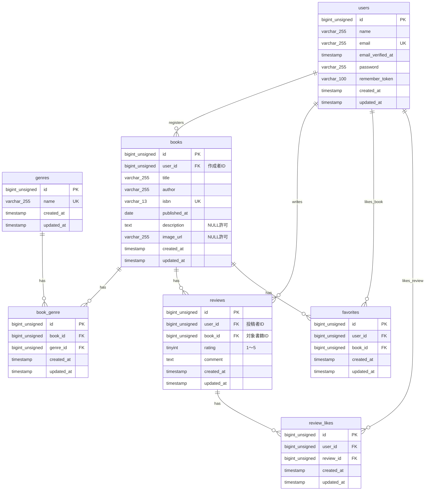

# COACHTECH 書籍レビューアプリ「BookShelf」（基本機能版）

書籍の管理やレビュー、お気に入り、いいね登録、ジャンル分類、ランキング機能、および外部アプリケーション向けの公開APIを提供する書籍レビューアプリケーションです。

## 作成者

遠山　弘乃　（とおやま　ひろの）

## 使用技術

- PHP 8.2
- Laravel 10.x
- MySQL 8.4
- Docker / Laravel Sail
- Vite / Tailwind CSS 3.4
- Laravel Fortify（認証）
- phpMyAdmin

## ER図



## 開発環境URL

- アプリケーション: http://localhost

- phpMyAdmin: http://localhost:8080

## 動作環境

- Docker
- Docker Compose
- WSL2 (Ubuntu 24.04.3 LTS 推奨)

## 環境構築手順

1.  **リポジトリの準備**

    

2. **.envファイルの確認**

    `.env.example` をコピーして` .env` を作成します。

    ```bash
    cp .env.example .env
    ```

    `.env` ファイル内のDB接続情報がSail向けになっているか確認します。`.env.example` のデフォルト値はSail向けではないため、以下のように変更してください。

    ```ini
    DB_CONNECTION=mysql
    DB_HOST=mysql
    DB_PORT=3306
    DB_DATABASE=bookshelf_app
    DB_USERNAME=sail
    DB_PASSWORD=password
    ```

3. **Composer依存パッケージのインストール**

    プロジェクトの初回セットアップ時は、`vendor` ディレクトリが存在しないため sail コマンドを使用できません。 以下のDockerコマンドを実行して、コンテナ内で `composer install` を実行します。
    注意: curl -s "https://laravel.build/..." は最新版のLaravelをインストールするため、今回は使用しません。

    以下のDockerコマンドを実行して、Laravel 10.xを明示的に指定してプロジェクトを作成します。

    ```bash
    docker run --rm 
        -u "$(id -u):$(id -g)" 
        -v "$(pwd):/var/www/html" 
        -w /var/www/html 
        -e COMPOSER_CACHE_DIR=/tmp/composer_cache laravelsail/php82-composer:latest composer create-project laravel/laravel:^10.0 bookshelf-app
    ```
4. **Laravel Sailの起動**

    以下のコマンドでDockerコンテナを起動します。
    ```bash
    ./vendor/bin/sail up -d
    ```

    エイリアスの設定（推奨）
    毎回 `./vendor/bin/sail` と入力するのは手間なので、エイリアスを設定すると便利です。
    ```bash
    alias sail='[ -f sail ] && bash sail || bash vendor/bin/sail'
    ```

5. **アプリケーションキーの生成**

    ```bash
    sail artisan key:generate
    ```

6. **データベースのマイグレーションと初期データ投入**
    以下のコマンドでテーブルを作成し、ダミーデータを投入します。

    ```bash
    sail artisan migrate:fresh --seed
    ```
    ※データベースの接続エラーが起きた場合は、一度以下のコマンドでコンテナを初期化してください。
    ```bash
        sail down -v
        sail up -d //コマンド実行後にSQLコンテナが立ち上がるまで時間がかかります。30秒ほどお待ちください。
        sail artisan migrate:fresh --seed
    ```

7. **フロントエンドのビルド**

    ```bash
    sail npm install
    sail npm install alpinejs
    sail npm install -D tailwindcss@^3.4.0 @tailwindcss/forms postcss autoprefixer
    ```
    （Tailwind CSS本体と、フォーム用デザインパーツ、ブラウザ自動調整ツールを一括でインストールします）

    ```bash
    sail npx tailwindcss init -p
    sail npm run dev
    ```
    `npm run dev` は開発中、常に起動したままにしてください。

8. **アプリケーションへのアクセス**

    ブラウザで http://localhost にアクセスします。

## テスト実行

```bash
sail artisan test
```
カバレッジ付きで実行する場合:
```bash
sail artisan test --coverage
```

## 機能一覧（基本機能）

- ユーザー認証機能（会員登録・ログイン・ログアウト）※Laravel Fortify
- 書籍管理機能（一覧表示・詳細表示・新規登録・編集・削除）
- ジャンル管理機能（一覧表示・詳細表示・新規登録・編集）
- レビュー機能（投稿・編集）
- お気に入り機能（登録・解除のトグル）
- いいね機能（レビューへのいいね登録・解除のトグル）
- ランキング機能（レビュー平均評価TOP10の表示）
- 公開API機能（認証なしの書籍CRUD）

## APIエンドポイント一覧

 認証不要の公開APIです。全エンドポイントは `/api/v1` プレフィックス配下に定義されています。

| HTTPメソッド | URI | 概要 | 認証（基本） |
|---|---|---|---|
| GET | /api/v1/books | 書籍一覧を取得する（検索・ページネーション付き） | 不要 |
| GET | /api/v1/books/{book} | 書籍詳細を取得する | 不要 |
| POST | /api/v1/books | 書籍を新規登録する | 不要 |
| PUT | /api/v1/books/{book} | 書籍を更新する | 不要 |
| DELETE | /api/v1/books/{book} | 書籍を削除する | 不要 |


# 書籍レビューアプリ「BookShelf」（基本機能版）

クライアント企業の要望に基づく、書籍レビューアプリケーションのバックエンド開発プロジェクトです。

## 1. 開発環境
- OS: WSL2 (Ubuntu 24.04.3 LTS)
- 言語: PHP 8.2
- フレームワーク: Laravel 10.x
- データベース: MySQL 8.4
- ツール: Docker / Laravel Sail / phpMyAdmin (localhost:8080)

## 2. 実装予定の機能一覧（基本機能）
- [ ] ユーザー認証機能（会員登録・ログイン・ログアウト） ※Laravel Fortify
- [ ] 書籍管理機能（一覧表示・詳細表示・新規登録・編集・削除）
- [ ] ジャンル管理機能（一覧表示・詳細表示・新規登録・編集）
- [ ] レビュー機能（投稿・編集）
- [ ] お気に入り機能（登録・解除のトグル）
- [ ] いいね機能（レビューへのいいね登録・解除のトグル）
- [ ] ランキング機能（レビュー平均評価TOP10の表示）
- [ ] 公開API機能（認証なしの書籍CRUD）

## 3. テーブル設計 ＆ ER図
（※ここに自分で考えたテーブル構造や、ER図の画像を後で貼り付けます）

## 4. バリデーションルール設計
（※ここに画面ごとの入力チェックルールを後で書き込みます）