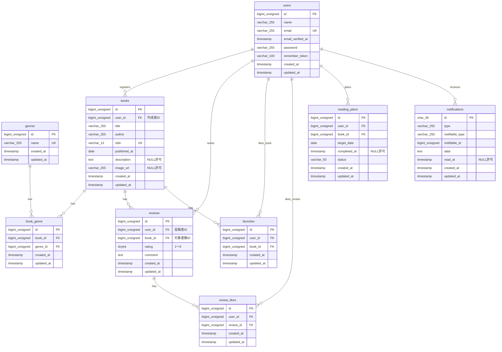
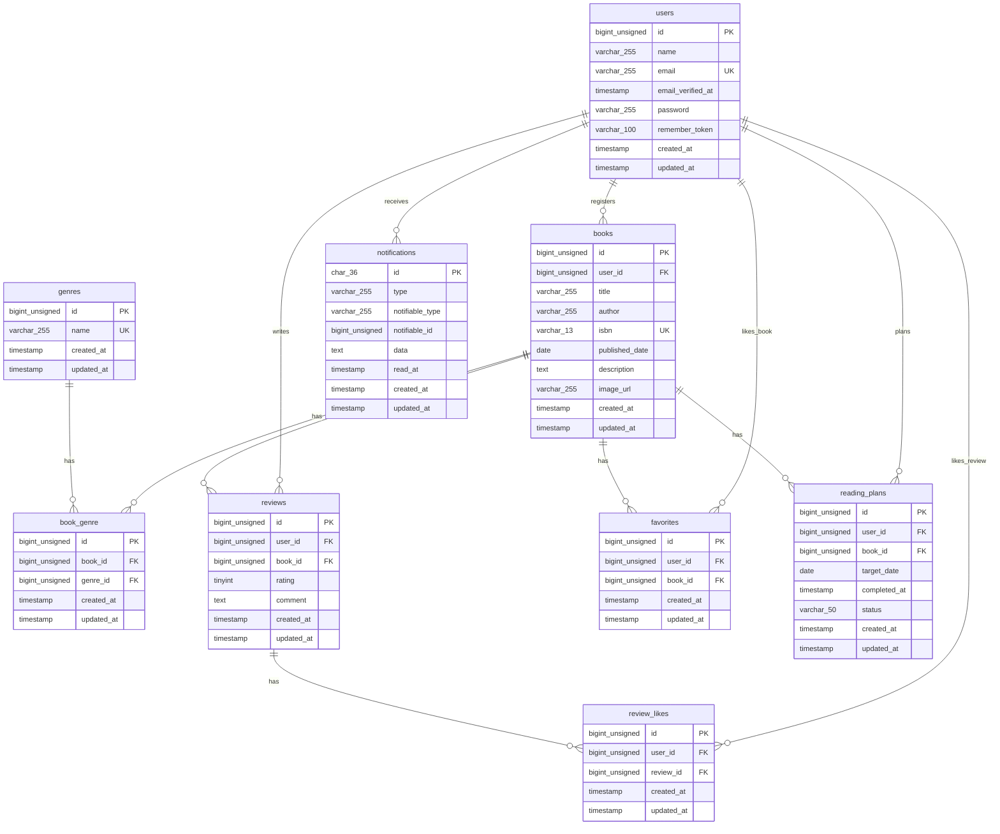

# COACHTECH 書籍レビューアプリ「BookShelf」（

書籍の管理やレビュー、お気に入り、いいね登録、ジャンル分類、ランキング機能、および外部アプリケーション向けの公開書計画・読書レポート・通知・検索/ソート・Sanctum認証付きAPIを提供する書籍レビューアプリケーションです。

## 作成者

遠山　弘乃　（とおやま　ひろの）

## 使用技術

- PHP 8.2
- Laravel 10.x
- MySQL 8.4
- Docker / Laravel Sail
- Vite / Tailwind CSS 3.4
- Laravel Fortify（認証）
- phpMyAdmin

## ER図



## 開発環境URL

- アプリケーション: http://localhost

- phpMyAdmin: http://localhost:8080

## 動作環境

- Docker
- Docker Compose
- WSL2 (Ubuntu 24.04.3 LTS 推奨)

## 環境構築手順

1.  **リポジトリの準備**

    

2. **.envファイルの確認**

    `.env.example` をコピーして` .env` を作成します。

    ```bash
    cp .env.example .env
    ```

    `.env` ファイル内のDB接続情報がSail向けになっているか確認します。`.env.example` のデフォルト値はSail向けではないため、以下のように変更してください。

    ```ini
    DB_CONNECTION=mysql
    DB_HOST=mysql
    DB_PORT=3306
    DB_DATABASE=bookshelf_app
    DB_USERNAME=sail
    DB_PASSWORD=password
    ```

3. **Laravel Sailの起動**

    以下のコマンドでDockerコンテナを起動します。
    ```bash
    ./vendor/bin/sail up -d
    ```

    エイリアスの設定（推奨）
    毎回 `./vendor/bin/sail` と入力するのは手間なので、エイリアスを設定すると便利です。
    ```bash
    alias sail='[ -f sail ] && bash sail || bash vendor/bin/sail'
    ```

4. **アプリケーションキーの生成**

    ```bash
    sail artisan key:generate
    ```

5. **データベースのマイグレーションと初期データ投入**
    以下のコマンドでテーブルを作成し、ダミーデータを投入します。

    ```bash
    sail artisan migrate:fresh --seed
    ```
    ※データベースの接続エラーが起きた場合は、一度以下のコマンドでコンテナを初期化してください。
    ```bash
        sail down -v
        sail up -d //コマンド実行後にSQLコンテナが立ち上がるまで時間がかかります。30秒ほどお待ちください。
        sail artisan migrate:fresh --seed
    ```

6. **フロントエンドのビルド**

    ```bash
    sail npm install
    sail npm install alpinejs
    sail npm install -D tailwindcss@^3.4.0 @tailwindcss/forms postcss autoprefixer
    ```
    （Tailwind CSS本体と、フォーム用デザインパーツ、ブラウザ自動調整ツールを一括でインストールします）

    ```bash
    sail npx tailwindcss init -p
    sail npm run dev
    ```
    `npm run dev` は開発中、常に起動したままにしてください。

7. **アプリケーションへのアクセス**

    ブラウザで http://localhost にアクセスします。

## テスト実行

```bash
sail artisan test
```
カバレッジ付きで実行する場合:
```bash
sail artisan test --coverage
```

## 機能一覧

- ユーザー認証機能（会員登録・ログイン・ログアウト）※Laravel Fortify
- 書籍管理機能（一覧表示・詳細表示・新規登録・編集・削除）
- ジャンル管理機能（一覧表示・詳細表示・新規登録・編集）
- レビュー機能（投稿・編集）
- お気に入り機能（登録・解除のトグル）
- いいね機能（レビューへのいいね登録・解除のトグル）
- ランキング機能（レビュー平均評価TOP10の表示）
- 公開API機能（認証なしの書籍CRUD）
- 書籍検索・絞り込み・並び替え（一覧画面）
- 読書計画管理（作成・編集・削除・完了処理・ステータス絞り込み・ReadingPlanStatus Enum）
- マイ読書レポート（基本統計・評価分布・高評価書籍TOP5・ジャンル別評価傾向TOP5）
- 通知機能（通知一覧表示・既読更新・未読件数表示）
- API認証（Laravel Sanctum 等）および FormRequest / ApiResource による入出力整備

## APIエンドポイント一覧

 認証不要の公開APIです。全エンドポイントは `/api/v1` プレフィックス配下に定義されています。

| HTTPメソッド | URI | 概要 | 認証 |
|---|---|---|---|
| GET | /api/v1/books | 書籍一覧を取得する（検索・ページネーション付き） | 不要 |
| GET | /api/v1/books/{book} | 書籍詳細を取得する | 不要 |
| POST | /api/v1/books | 書籍を新規登録する | 不要 |
| PUT | /api/v1/books/{book} | 書籍を更新する | 不要 |
| DELETE | /api/v1/books/{book} | 書籍を削除する | 不要 |
| POST | /api/v1/login (または/api/v1/login)| ログインしてAPIトークンを発行する | 不要 | 

## 認証が必要なエンドポイント（auth:sanctum）
| HTTPメソッド | URI | 概要 | 認証 |
|---|---|---|---|
| POST | /api/v1/books | 書籍を新規登録する | auth:sanctum |
| PUT / PATCH | /api/v1/books/{book} | 書籍を更新する | auth:sanctum |
| DELETE | /api/v1/books/{book} | 書籍を削除する | auth:sanctum |
| POST | /api/logout（または /api/v1/logout） | ログアウトする（トークン無効化）| auth:sanctum |


# 書籍レビューアプリ「BookShelf」

クライアント企業の要望に基づく、書籍レビューアプリケーションのバックエンド開発プロジェクトです。

## 1. 開発環境
- OS: WSL2 (Ubuntu 24.04.3 LTS)
- 言語: PHP 8.2
- フレームワーク: Laravel 10.x
- データベース: MySQL 8.4
- ツール: Docker / Laravel Sail / phpMyAdmin (localhost:8080)

## 2. 実装予定の機能一覧（基本機能）
- [ ] ユーザー認証機能（会員登録・ログイン・ログアウト） ※Laravel Fortify
- [ ] 書籍管理機能（一覧表示・詳細表示・新規登録・編集・削除）
- [ ] ジャンル管理機能（一覧表示・詳細表示・新規登録・編集）
- [ ] レビュー機能（投稿・編集）
- [ ] お気に入り機能（登録・解除のトグル）
- [ ] いいね機能（レビューへのいいね登録・解除のトグル）
- [ ] ランキング機能（レビュー平均評価TOP10の表示）
- [ ] 公開API機能（認証なしの書籍CRUD）

## 3. テーブル設計 ＆ ER図
### 主なテーブル一覧
- `users`: ユーザー情報
- `books`: 書籍情報
- `genres`: ジャンルマスタ
- `book_genre`: 書籍とジャンルの中間テーブル（多対多）
- `reviews`: レビュー・評価（1〜5）
- `favorites`: お気に入り書籍（中間テーブル）
- `review_likes`: レビューいいね（中間テーブル）
- `reading_plans`: 読書計画（対象書籍・期日・完了日・ステータス）
- `notifications`: 通知データ（Laravel標準通知テーブル）


## 4. バリデーションルール設計
## 4. バリデーションルール設計

### API 書籍登録・更新（`ApiStoreBookRequest` / `ApiUpdateBookRequest`）
- `title`: `required|string|max:255`
- `author`: `required|string|max:255`
- `isbn`: `required|string|regex:/^[0-9]{13}$/|unique:books,isbn`（更新時は対象IDを除外）
- `published_date`: `required|date`
- `description`: `nullable|string|max:1000`
- `image_url`: `nullable|url|max:255`
- `genres`: `required|array` / `genres.*`: `integer|exists:genres,id`

### Web 書籍登録・更新（`StoreBookRequest` / `UpdateBookRequest`）
- `title`: `required|string|max:255`
- `author`: `required|string|max:255`
- `isbn`: `required|string|regex:/^[0-9]{13}$/|unique:books,isbn`（更新時は対象IDを除外）
- 出版日・ジャンル項目: 実実装に合わせて `published_date` / `genres`（または `published_at` / `genre_ids`）を適用
- `description`: `nullable|string|max:1000`
- `image_url`: `nullable|url|max:255`

### レビュー投稿・更新（`StoreReviewRequest` / `UpdateReviewRequest`）
- `rating`: `required|integer|min:1|max:5`
- `review_text`: `nullable|string|max:500`

### ジャンル登録・更新（`StoreGenreRequest` / `UpdateGenreRequest`）
- `name`: `required|string|max:50|unique:genres,name`（更新時は対象IDを除外）

### 認証（`LoginRequest` / `RegisterRequest`）
- ログイン: `email`（`required|string|email|max:255`）、`password`（`required|string|min:8`）
- 会員登録: `name`（`required|string|max:255`）、`email`（`required|string|email|max:255|unique:users,email`）、`password`（`required|string|min:8|confirmed`）